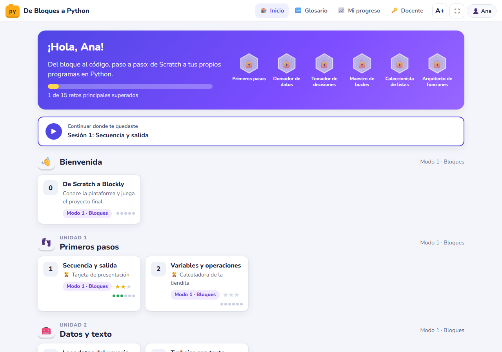
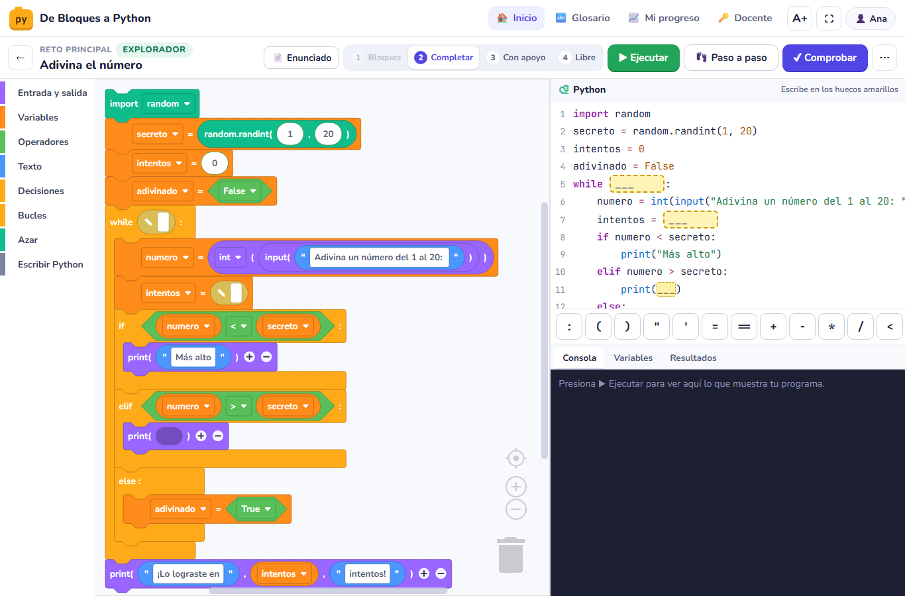
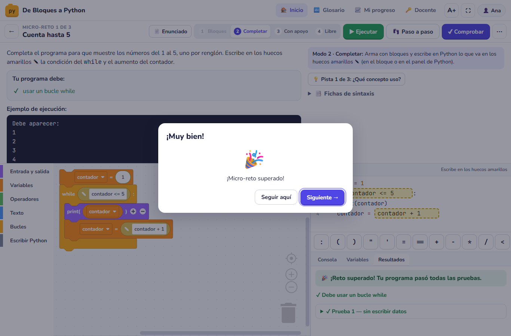
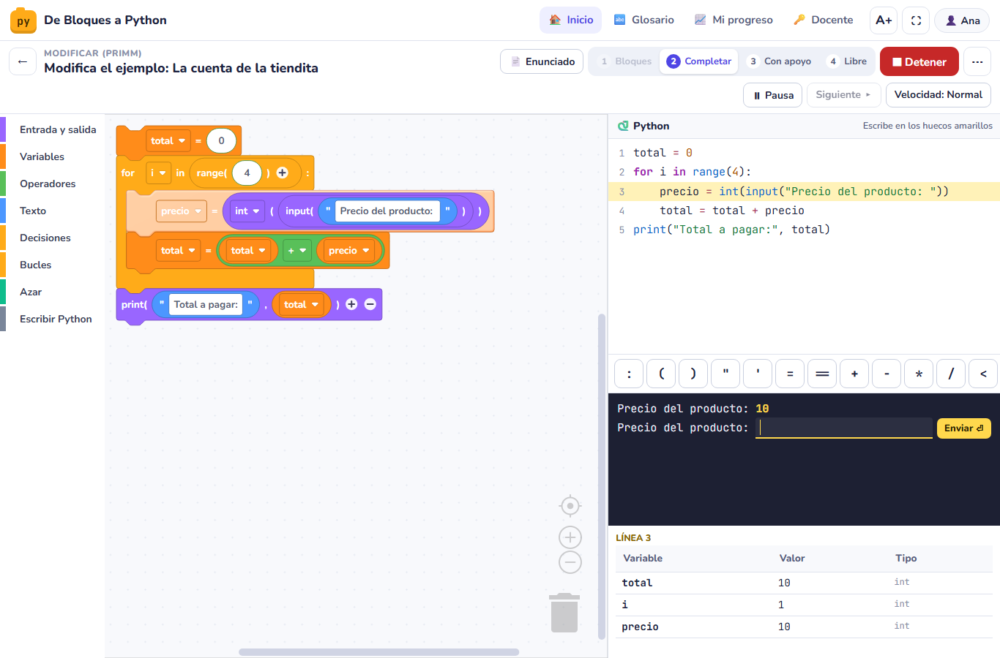
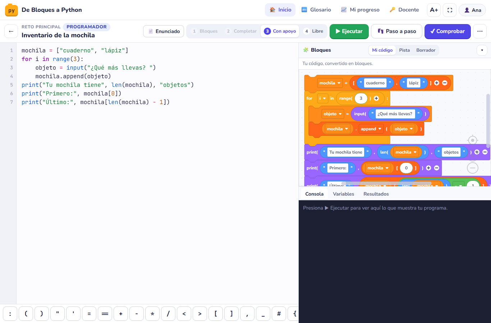
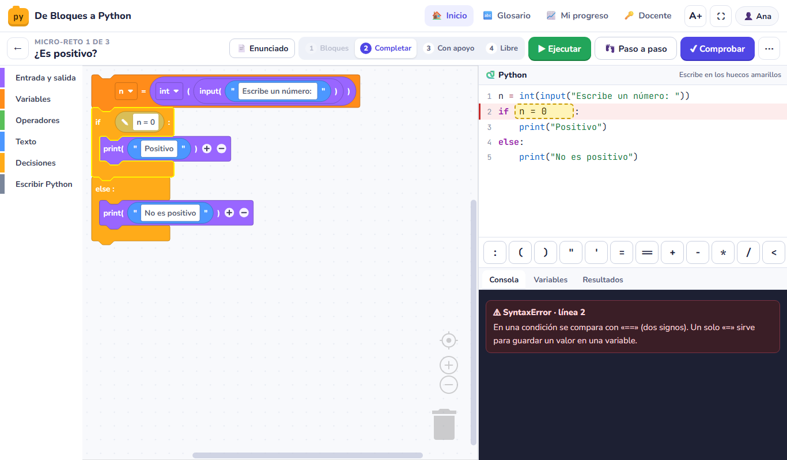

# De Bloques a Python

Plataforma de retos para el curso **«Fundamentos de Python con retos en Blockly»**: 17 sesiones de 60 minutos que llevan a alumnos de 1° de secundaria que vienen de Scratch a escribir sus propios programas en Python. Los bloques se retiran por etapas, siguiendo el modelo CLT4BP: de armar con bloques a escribir Python sin apoyo.

Es **un solo archivo HTML** que funciona en el navegador, incluido Safari en iPad, sin instalar nada y sin servidor. Está listo para publicarse en Google Sites.

## Qué incluye

- **Plataforma** (`dist/plataforma.html`):
  - Bloques «estilo Python» con los colores de Scratch. Cada bloque es una línea de Python real.
  - Panel de Python sincronizado: al tocar un bloque se resalta su línea, y al tocar una línea se selecciona su bloque.
  - Cuatro modos de trabajo: Bloques → Completar (huecos ✎ para escribir Python) → Con apoyo (editor de texto con bloques como pista) → Libre.
  - Ejecución con Skulpt: consola con `input()`, **paso a paso** con tabla de variables y botón para detener bucles infinitos.
  - Verificador con casos de prueba y restricciones. Explica qué falló y traduce los errores de Python al español.
  - Tres niveles por reto principal (Explorador, Programador, Maestro), pistas escalonadas, insignias por unidad y progreso guardado en el dispositivo, con exportación e importación.
  - Prueba diagnóstica y final, coevaluación con rúbrica, panel docente con soluciones, planes de clase y consolidación del grupo en CSV.
- **Contenido de las 17 sesiones** (`contenido/`): teoría con analogías y animaciones, fichas de sintaxis, glosario bilingüe, ejemplo resuelto (PRIMM), 43 micro-retos, 13 retos principales en tres niveles, 2 proyectos (mini-proyecto y proyecto final con 4 opciones), 13 retos extra, 28 preguntas puente, autoevaluación, 16 tickets de salida y planes de clase.
- **Materiales generados**: `soluciones/` (101 soluciones de referencia en `.py`), `docs/planes-de-clase.md` y `docs/instrumentos-de-evaluacion.md`.
- **Documentación**: [docs/publicar-en-google-sites.md](docs/publicar-en-google-sites.md) y [docs/guia-docente.md](docs/guia-docente.md).

## Capturas

| | |
|---|---|
|  |  |
| Portada: unidades, sesiones, estrellas e insignias | Modo 2: bloques con huecos ✎ y Python sincronizado |
|  |  |
| Comprobar: casos de prueba y felicitación | 👣 Paso a paso: línea actual y variables |
|  |  |
| Modo 3: editor de Python con bloques como pista | Errores explicados en español |

## Uso rápido

1. Abre `dist/plataforma.html` en el navegador para probarla.
2. Publícala en Google Sites siguiendo [docs/publicar-en-google-sites.md](docs/publicar-en-google-sites.md).
3. Antes de la primera clase, cambia el PIN docente en `configuracion.json` (por defecto `2468`) y vuelve a construir.

## Editar retos y volver a construir

El contenido está en `contenido/*.json` (una sesión por archivo); la plataforma no se toca. Requiere Python 3.9 o posterior.

```
python construir.py                        # valida, prueba las soluciones con Python y genera dist/
python construir.py --rapido               # genera dist/ sin probar las soluciones
python herramientas/probar_plataforma.py   # prueba todos los retos en un navegador real (Edge o Chrome)
```

La primera construcción descarga Blockly y Skulpt (versiones fijas) a `herramientas/vendor/cache/`.

## Estructura

```
configuracion.json      nombre del curso, PIN docente, pesos de evaluación, enlaces
contenido/              unidades, prueba de lectura y las 17 sesiones (JSON)
src/                    código de la plataforma (plantilla, estilos y módulos JS)
construir.py            junta todo en un solo HTML y genera soluciones y documentos
dist/                   plataforma.html (para Google Sites) y plataforma-sin-conexion.html
soluciones/             soluciones de referencia (.py), generadas
docs/                   guías, planes de clase e instrumentos de evaluación
herramientas/           banco de pruebas en navegador y capturas de pantalla
```

## Componentes

Blockly 11.2.2 (Apache 2.0) · Skulpt, compilación del 5-mar-2026 (MIT) · fuentes Nunito y JetBrains Mono (OFL).
